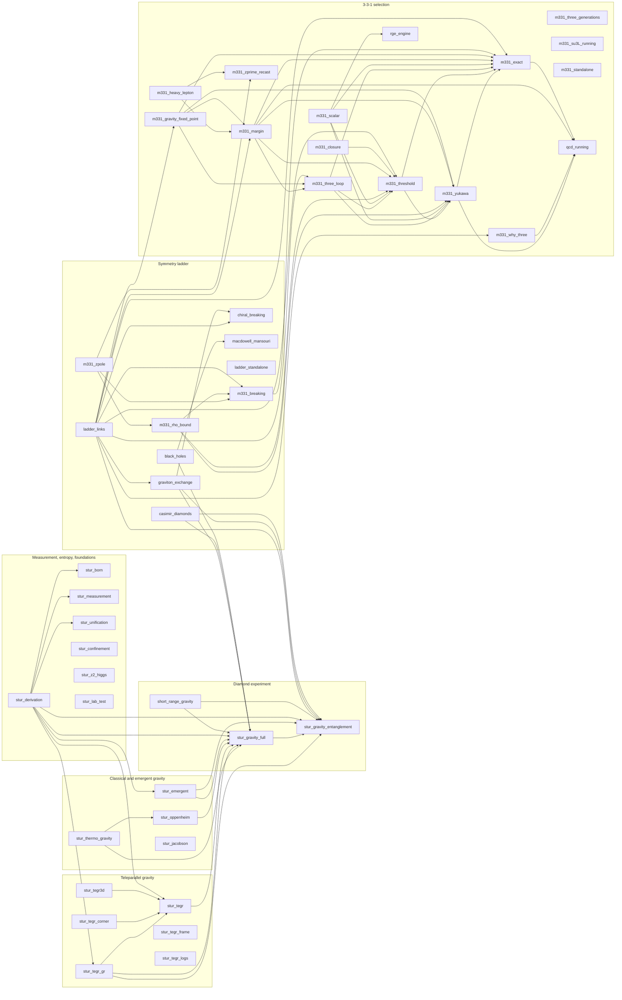

# Dependency map

*Generated by [`tools/dependency_map.py`](tools/dependency_map.py); do not edit by hand. Run `python3 tools/dependency_map.py` after changing a script; `tests/test_dependency_map.py` fails if this page is out of date or if a copied value drifts from its source without a stated reason.*

This page records which script feeds which, and which physical quantities each one uses. A quantity that two parts of the repository share, but don't import from one place, is either a copy that can drift or a link between the parts that nothing checks yet.

## Summary

- **46 scripts** in `src/`, in 6 topics; **71 imports** between them, 28 of them across topics. 10 scripts import nothing from the others and nothing imports them.
- **53 catalogued quantities** (38 measured inputs, 15 derived in the repository), found as 186 literals in the source.
- **44 quantities are typed in more than one script**; 16 of them are shared by more than one topic.
- **2 copies differ from their source for a stated reason**; **0 differ without one (drift).**

## Imports

Solid arrows are imports (`A --> B`: A uses B). Scripts with no arrows stand alone.

### Across topics

| From | To | Names used |
|---|---|---|
| `black_holes` (Symmetry ladder) | `stur_gravity_full` (Diamond experiment) | `design_a` |
| `casimir_diamonds` (Symmetry ladder) | `stur_gravity_entanglement` (Diamond experiment) | `BASE`, `C`, `EPS_DIAMOND`, `G`, `HBAR`, `KB`, `branch_distances`, `casimir_energy`, `entangling_phase`, `phases`, `radius` |
| `casimir_diamonds` (Symmetry ladder) | `stur_gravity_full` (Diamond experiment) | `design_a`, `em_entangling_ratio`, `max_dipole` |
| `graviton_exchange` (Symmetry ladder) | `stur_gravity_entanglement` (Diamond experiment) | `G`, `HBAR` |
| `graviton_exchange` (Symmetry ladder) | `stur_gravity_full` (Diamond experiment) | `design_a`, `ramp_profile`, `trajectory_dphi` |
| `ladder_links` (Symmetry ladder) | `m331_exact` (3-3-1 selection) | `MODELS`, `M_PLANCK` |
| `ladder_links` (Symmetry ladder) | `m331_gravity_fixed_point` (3-3-1 selection) | `f_profile`, `f_separatrix_sm` |
| `ladder_links` (Symmetry ladder) | `m331_margin` (3-3-1 selection) | `ALPHA1`, `FLOORS`, `pole` |
| `ladder_links` (Symmetry ladder) | `m331_three_loop` (3-3-1 selection) | `WORST`, `pole` |
| `ladder_links` (Symmetry ladder) | `m331_threshold` (3-3-1 selection) | `GRID` |
| `ladder_links` (Symmetry ladder) | `m331_why_three` (3-3-1 selection) | `charges` |
| `ladder_links` (Symmetry ladder) | `stur_gravity_entanglement` (Diamond experiment) | `C`, `G`, `HBAR` |
| `m331_breaking` (Symmetry ladder) | `m331_exact` (3-3-1 selection) | `MODELS` |
| `m331_rho_bound` (Symmetry ladder) | `m331_threshold` (3-3-1 selection) | `gL_at`, `mzp_over_mv` |
| `m331_rho_bound` (Symmetry ladder) | `m331_yukawa` (3-3-1 selection) | `boundary` |
| `m331_zpole` (Symmetry ladder) | `m331_zprime_recast` (3-3-1 selection) | `g331`, `gE6`, `t8` |
| `stur_derivation` (Measurement, entropy, foundations) | `stur_emergent` (Classical and emergent gravity) | `cutoff_for_G`, `dp_rate`, `medium_evolution` |
| `stur_derivation` (Measurement, entropy, foundations) | `stur_gravity_entanglement` (Diamond experiment) | `BASE`, `branch_distances`, `negativity`, `radius`, `state` |
| `stur_derivation` (Measurement, entropy, foundations) | `stur_gravity_full` (Diamond experiment) | `design_a` |
| `stur_derivation` (Measurement, entropy, foundations) | `stur_tegr` (Teleparallel gravity) | `grad_form`, `graviton_count`, `identity_check`, `newtonian_lagrangian` |
| `stur_derivation` (Measurement, entropy, foundations) | `stur_tegr_gr` (Teleparallel gravity) | `GM_SUN`, `MERCURY_A`, `MERCURY_E`, `MERCURY_P`, `R_SUN`, `gps_offset_us_per_day`, `interaction_energy_tegr`, `light_deflection`, `perihelion_shift`, `ppn_gamma`, `solve_spherical` |
| `stur_emergent` (Classical and emergent gravity) | `stur_gravity_entanglement` (Diamond experiment) | `negativity` |
| `stur_emergent` (Classical and emergent gravity) | `stur_gravity_full` (Diamond experiment) | `design_a` |
| `stur_oppenheim` (Classical and emergent gravity) | `stur_gravity_full` (Diamond experiment) | `design_a` |
| `stur_tegr` (Teleparallel gravity) | `stur_gravity_full` (Diamond experiment) | `design_a` |
| `stur_tegr_gr` (Teleparallel gravity) | `stur_gravity_entanglement` (Diamond experiment) | `BASE`, `branch_distances`, `entangling_phase`, `phases`, `radius` |
| `stur_tegr_gr` (Teleparallel gravity) | `stur_gravity_full` (Diamond experiment) | `design_a` |
| `stur_thermo_gravity` (Classical and emergent gravity) | `stur_gravity_full` (Diamond experiment) | `design_a` |

### By topic

**3-3-1 selection**

| Script | Imports | What it is |
|---|---|---|
| [`m331_why_three`](src/m331_why_three.py) | `qcd_running` | Unifying-equation search, front 5: why N_c = 3 colours? N_c sets the thirds (front 4), the Z3 twist and the three quarks in a baryon |
| [`m331_three_generations`](src/m331_three_generations.py) | — | Unifying-equation search, front 6: why three generations? (3-3-1 models) KNOWN framework (Pisano-Pleitez 1992, Frampton 1992): SU(3)_C x SU( |
| [`m331_su3L_running`](src/m331_su3L_running.py) | — | Unifying-equation search, front 7: can SU(3)_L running remove N_c = 5 (and 7, 9, ...)? With N_g = N_c (front 6), the SU(3)_L-charged left-ha |
| [`m331_exact`](src/m331_exact.py) | `qcd_running` | Unifying-equation search, front 7b: firming up 'N_c = N_g = 3' with exact charges and two-loop gauge running |
| [`m331_yukawa`](src/m331_yukawa.py) | `m331_exact`, `qcd_running` | Unifying-equation search, front 7d: the three weak spots of 'N_c = N_g = 3' (NOTE_331.md) |
| [`m331_threshold`](src/m331_threshold.py) | `m331_exact`, `m331_yukawa` | Unifying-equation search, front 7e: one-loop threshold matching at the 3-3-1 scale |
| [`m331_closure`](src/m331_closure.py) | `m331_threshold` | Unifying-equation search, front 7f: closing the remaining assumptions of N_c = N_g = 3 |
| [`m331_scalar`](src/m331_scalar.py) | `m331_exact`, `m331_threshold`, `m331_yukawa`, `rge_engine` | Unifying-equation search, front 7g: does the 3-3-1 scalar sector itself survive to the Planck scale? The selection of N_c = 3 asks that the  |
| [`m331_three_loop`](src/m331_three_loop.py) | `m331_exact`, `m331_threshold`, `m331_yukawa` | Three-loop gauge running for the 3-3-1 selection (NOTE_331.md, section 3d) |
| [`m331_margin`](src/m331_margin.py) | `m331_exact`, `m331_three_loop`, `m331_threshold`, `m331_yukawa`, `qcd_running` | The narrow beta = +1/sqrt3 margin, tightened (NOTE_331.md, section 3e) |
| [`m331_zprime_recast`](src/m331_zprime_recast.py) | — | Recast of the ATLAS 13 TeV, 139 fb^-1 dilepton search for the Z' of the beta = +-1/sqrt3 3-3-1 models |
| [`m331_heavy_lepton`](src/m331_heavy_lepton.py) | `m331_margin`, `m331_zprime_recast` | The heavy charged leptons of the beta = +1/sqrt3 model against the LHC (NOTE_331.md, section 3f) |
| [`m331_gravity_fixed_point`](src/m331_gravity_fixed_point.py) | `m331_exact`, `m331_margin`, `m331_three_loop`, `m331_yukawa` | Gravity above the Planck scale and the 3-3-1 gauge couplings: the asymptotic-safety estimate (NOTE_331.md asks every coupling to stay pertur |
| [`m331_standalone`](src/m331_standalone.py) | — | Three colours and three generations from perturbativity in 3-3-1 models |
| [`qcd_running`](src/qcd_running.py) | — | Two-loop MS-bar running of the strong coupling, used by the 3-3-1 scripts. |
| [`rge_engine`](src/rge_engine.py) | — | General one-loop RGEs for quartic and Yukawa couplings (real scalars, two-component fermions) |

**Symmetry ladder**

| Script | Imports | What it is |
|---|---|---|
| [`m331_breaking`](src/m331_breaking.py) | `m331_exact` | Symmetry breaking in 3-3-1, derived: SU(3)_L x U(1)_X -> SU(2)_L x U(1)_Y -> U(1)_em |
| [`chiral_breaking`](src/chiral_breaking.py) | — | The strong-force rung of the symmetry-breaking ladder (SYMMETRY_LADDER.md): chiral symmetry breaking, pions, and the nuclear force |
| [`casimir_diamonds`](src/casimir_diamonds.py) | `stur_gravity_entanglement`, `stur_gravity_full` | The electromagnetic rung of the ladder (SYMMETRY_LADDER.md): why electromagnetism is the background in the diamond experiment, and its stren |
| [`graviton_exchange`](src/graviton_exchange.py) | `chiral_breaking`, `stur_gravity_entanglement`, `stur_gravity_full` | The gravity rung of the ladder (SYMMETRY_LADDER.md): from linearized GR to the entangling phase of the two-diamond experiment |
| [`macdowell_mansouri`](src/macdowell_mansouri.py) | — | The gravity rung as a broken gauge theory: MacDowell-Mansouri (1977) and Stelle-West (1980) |
| [`black_holes`](src/black_holes.py) | `macdowell_mansouri`, `stur_gravity_full` | Black holes: the strong-field end of gravity's side column (SYMMETRY_LADDER.md, rung 6) |
| [`ladder_links`](src/ladder_links.py) | `chiral_breaking`, `graviton_exchange`, `m331_breaking`, `m331_exact`, `m331_gravity_fixed_point`, `m331_margin`, `m331_three_loop`, `m331_threshold`, `m331_why_three`, `stur_gravity_entanglement` | Links between the rungs of the symmetry-breaking ladder (SYMMETRY_LADDER.md): places where one rung's output is another rung's input, checke |
| [`ladder_standalone`](src/ladder_standalone.py) | — | The symmetry-breaking ladder, from 3-3-1 to the two-diamond gravity experiment |
| [`m331_rho_bound`](src/m331_rho_bound.py) | `m331_breaking`, `m331_threshold`, `m331_yukawa` | The rho parameter and the 3-3-1 scale: what electroweak precision says about w, from the tree-level Z-Z' mixing of rung 1 (src/m331_breaking |
| [`m331_zpole`](src/m331_zpole.py) | `m331_breaking`, `m331_rho_bound`, `m331_zprime_recast` | The Z-pole observables and the 3-3-1 scale: the full tree-level electroweak-precision test of Z-Z' mixing, validated on the E6 Z' bosons, ag |

**Diamond experiment**

| Script | Imports | What it is |
|---|---|---|
| [`stur_gravity_entanglement`](src/stur_gravity_entanglement.py) | — | Gravity-induced entanglement (Bose et al., PRL 119, 240401 (2017); Marletto & Vedral, PRL 119, 240402 (2017)) |
| [`stur_gravity_full`](src/stur_gravity_full.py) | `stur_gravity_entanglement` | Gravity-induced entanglement, modelled to the end: everything stur_gravity_entanglement.py left out, then a full design search |
| [`short_range_gravity`](src/short_range_gravity.py) | `stur_gravity_entanglement`, `stur_gravity_full` | Short-range gravity with the two-diamond experiment: how far design A could test Newton's 1/r law, against a Yukawa modification V(r) = -G m |

**Classical and emergent gravity**

| Script | Imports | What it is |
|---|---|---|
| [`stur_oppenheim`](src/stur_oppenheim.py) | `stur_gravity_full` | Oppenheim's classical gravity: the decoherence-diffusion trade-off, and what one levitated particle can decide |
| [`stur_thermo_gravity`](src/stur_thermo_gravity.py) | `stur_gravity_full`, `stur_oppenheim` | Gravity as an equation of state: the noise it must carry, and what that noise predicts |
| [`stur_emergent`](src/stur_emergent.py) | `stur_gravity_entanglement`, `stur_gravity_full` | The question turned around: gravity as a CONSEQUENCE of the quantum level, not a field that acts on quantum particles from outside |
| [`stur_jacobson`](src/stur_jacobson.py) | — | D3 re-derived: Einstein's equation from the Clausius relation on local horizons (Jacobson, PRL 75, 1260 (1995)), each step checked symbolica |

**Teleparallel gravity**

| Script | Imports | What it is |
|---|---|---|
| [`stur_tegr`](src/stur_tegr.py) | `stur_gravity_full` | Gravity in TEGR (the Teleparallel Equivalent of General Relativity), applied to the double slit / gravity-entanglement chain of MEASUREMENT. |
| [`stur_tegr_gr`](src/stur_tegr_gr.py) | `stur_gravity_entanglement`, `stur_gravity_full`, `stur_tegr` | TEGR as the base theory: GR's results derived from it, and the gravity-entanglement experiment's inputs computed from TEGR's torsion field |
| [`stur_tegr3d`](src/stur_tegr3d.py) | `stur_tegr` | Teleparallel gravity in three dimensions, and the quantum amplitude it shares with loop quantum gravity there (worked example; every result  |
| [`stur_tegr_corner`](src/stur_tegr_corner.py) | `stur_tegr` | Where the entropy sits in TEGR: Noether charges, the corner term and the frame |
| [`stur_tegr_frame`](src/stur_tegr_frame.py) | — | The frame as a corner degree of freedom: linearized TEGR's corner symplectic form |
| [`stur_tegr_logs`](src/stur_tegr_logs.py) | — | Does TEGR's frame change the logarithmic correction to black-hole entropy? stur_tegr_frame Q5-Q8: TEGR's frame at a corner is a Lorentz coad |

**Measurement, entropy, foundations**

| Script | Imports | What it is |
|---|---|---|
| [`stur_derivation`](src/stur_derivation.py) | `stur_born`, `stur_emergent`, `stur_gravity_entanglement`, `stur_gravity_full`, `stur_measurement`, `stur_tegr`, `stur_tegr_gr`, `stur_unification` | The equation, derived from the quantum level up |
| [`stur_born`](src/stur_born.py) | — | The Born rule, derived from the quantum level instead of assumed |
| [`stur_measurement`](src/stur_measurement.py) | — | Measurement, the double slit, and entanglement: three proposed mechanisms, tested |
| [`stur_unification`](src/stur_unification.py) | — | Does ONE known equation govern measurement, the vacuum and horizons? Candidate (KNOWN pieces only): D(rho \|\| sigma) = Delta<K_sigma> - Delta |
| [`stur_confinement`](src/stur_confinement.py) | — | Unification search, step 2: the QCD-type sector |
| [`stur_z2_higgs`](src/stur_z2_higgs.py) | — | Unification search, step 3b: Z2 gauge-Higgs model, heavy DYNAMICAL charges |
| [`stur_lab_test`](src/stur_lab_test.py) | — | One trapped ion: visibility loss counts exchanged quanta, tested against an alternative ansatz with the opposite temperature dependence |

## Quantities shared across topics: the candidate links

Each row is one quantity typed into scripts of more than one topic. Where it is an input, the topics agree only because the same number was typed twice; where it is derived, one topic's output is another's input.

| Quantity | Kind | Topics | Scripts | What it connects |
|---|---|---|---|---|
| Newton's G (m³ kg⁻¹ s⁻²) | input | Classical and emergent gravity, Diamond experiment, Measurement, entropy, foundations, Symmetry ladder, Teleparallel gravity | `black_holes`, `ladder_links`, `ladder_standalone`, `stur_derivation`, `stur_emergent`, `stur_gravity_entanglement`, `stur_oppenheim`, `stur_tegr`, `stur_tegr_gr`, `stur_thermo_gravity` | gravity's only input; it also fixes M_Pl, the 3-3-1 cutoff |
| c (m/s) | input | Classical and emergent gravity, Diamond experiment, Measurement, entropy, foundations, Symmetry ladder, Teleparallel gravity | `black_holes`, `ladder_links`, `ladder_standalone`, `stur_derivation`, `stur_emergent`, `stur_gravity_entanglement`, `stur_measurement`, `stur_oppenheim`, `stur_tegr`, `stur_tegr_gr`, `stur_thermo_gravity` | exact by definition, so copies cannot drift |
| ħ (J s) | input | Classical and emergent gravity, Diamond experiment, Measurement, entropy, foundations, Symmetry ladder, Teleparallel gravity | `black_holes`, `ladder_links`, `ladder_standalone`, `stur_derivation`, `stur_emergent`, `stur_gravity_entanglement`, `stur_oppenheim`, `stur_tegr`, `stur_tegr_gr`, `stur_thermo_gravity` | exact by definition, so copies cannot drift |
| 1/4πε₀ (N m² C⁻²) | input | Diamond experiment, Measurement, entropy, foundations, Symmetry ladder | `ladder_links`, `ladder_standalone`, `stur_gravity_full`, `stur_measurement` |  |
| atomic mass unit (kg) | input | Classical and emergent gravity, Diamond experiment, Symmetry ladder | `ladder_links`, `ladder_standalone`, `stur_emergent`, `stur_gravity_entanglement`, `stur_gravity_full`, `stur_oppenheim`, `stur_thermo_gravity` |  |
| e (C) | input | Diamond experiment, Measurement, entropy, foundations, Symmetry ladder | `black_holes`, `casimir_diamonds`, `ladder_links`, `ladder_standalone`, `stur_gravity_full`, `stur_measurement` | exact by definition, so copies cannot drift |
| k_B (J/K) | input | Diamond experiment, Measurement, entropy, foundations, Symmetry ladder | `black_holes`, `ladder_links`, `ladder_standalone`, `stur_derivation`, `stur_gravity_entanglement` | exact by definition, so copies cannot drift |
| 1/α(M_Z), MS-bar | input | 3-3-1 selection, Symmetry ladder | `ladder_standalone`, `m331_breaking`, `m331_exact`, `m331_heavy_lepton`, `m331_margin`, `m331_standalone`, `m331_su3L_running`, `m331_three_generations`, `m331_zpole`, `m331_zprime_recast` | with sin²θ_W(M_Z) it fixes the U(1)_X start of every 3-3-1 run |
| GM☉ (m³ s⁻²) | input | Symmetry ladder, Teleparallel gravity | `black_holes`, `ladder_standalone`, `stur_tegr_gr` | the Sun's mass scale: TEGR's solar-system tests and the black-hole rung's EHT and LVK masses |
| M_Z (GeV) | input | 3-3-1 selection, Symmetry ladder | `ladder_links`, `ladder_standalone`, `m331_breaking`, `m331_exact`, `m331_heavy_lepton`, `m331_standalone`, `m331_su3L_running`, `m331_three_generations`, `m331_yukawa`, `m331_zprime_recast`, `qcd_running` |  |
| Planck mass √(ħc/G) (GeV) | derived | 3-3-1 selection, Symmetry ladder | `black_holes`, `ladder_standalone`, `m331_exact`, `m331_standalone`, `m331_su3L_running` | the 3-3-1 selection's cutoff. It is typed as a number in the 3-3-1 scripts; it is √(ħc/G), the G the diamond experiment uses |
| diamond density (kg/m³) | input | Diamond experiment, Symmetry ladder | `ladder_standalone`, `stur_gravity_entanglement` |  |
| diamond permittivity | input | Diamond experiment, Symmetry ladder | `ladder_standalone`, `stur_gravity_entanglement` |  |
| electroweak vev (√2 G_F)^(−1/2) (GeV) | derived | 3-3-1 selection, Symmetry ladder | `ladder_standalone`, `m331_standalone`, `m331_yukawa` | derived in rung 1 and retyped in the 3-3-1 Yukawa scripts |
| sin²θ_W(M_Z), MS-bar | input | 3-3-1 selection, Symmetry ladder | `ladder_standalone`, `m331_breaking`, `m331_exact`, `m331_heavy_lepton`, `m331_margin`, `m331_standalone`, `m331_su3L_running`, `m331_three_generations`, `m331_zpole`, `m331_zprime_recast` |  |
| top-quark mass (GeV) | input | 3-3-1 selection, Symmetry ladder | `ladder_links`, `m331_margin`, `m331_scalar`, `m331_standalone`, `m331_yukawa`, `qcd_running` |  |

**Links through a formula.** Some quantities share inputs without sharing a number:

- **Planck mass √(ħc/G) (GeV) = 1.220890e19**, typed as a number in `black_holes`, `ladder_standalone`, `m331_exact`, `m331_standalone`, `m331_su3L_running` (3-3-1 selection, Symmetry ladder). It follows from G, ħ and c, which the gravity scripts type separately; src/ladder_links.py L3 (SYMMETRY_LADDER.md, link 3) checks that the two agree.
- **Planck length √(ħG/c³) (m) = 1.616255e-35**, typed as a number in `black_holes`, `ladder_standalone`, `macdowell_mansouri` (Symmetry ladder). It follows from G, ħ and c, which the gravity scripts type separately; nothing checks that the two agree except this page.

## Derived values typed by hand

Values computed in one script and retyped in others instead of imported. Each copy is checked against the value recomputed from its source.

| Quantity | Source | Value | Copies |
|---|---|---|---|
| Planck mass √(ħc/G) (GeV) | √(ħc/G) from G, ħ, c (this tool) | 1.220890e19 | `black_holes:86` 1.220890e19 (rounded); `ladder_standalone:1161` 1.220890e19 (rounded); `m331_exact:28` 1.220890e19 (rounded); `m331_standalone:66` 1.220890e19 (rounded); `m331_su3L_running:19` 1.220890e19 (rounded) |
| Planck length √(ħG/c³) (m) | √(ħG/c³) from G, ħ, c (this tool) | 1.616255e-35 | `black_holes:85` 1.616255e-35 (rounded); `ladder_standalone:115` 1.616255e-35 (rounded); `macdowell_mansouri:267` 1.616255e-35 (rounded) |
| electroweak vev (√2 G_F)^(−1/2) (GeV) | src/m331_breaking.py B7 | 246.22 | `ladder_standalone:363` 246.22 (rounded); `m331_standalone:65` 246.22 (rounded); `m331_yukawa:86` 246.22 (rounded) |
| sin²θ_W(4 TeV) | one-loop SM running from M_Z (m331_exact.run_two_loop) | 0.250507 | `m331_zprime_recast:68` 0.2505 (rounded) |
| 1/α(4 TeV) | one-loop SM running from M_Z (m331_exact.run_two_loop) | 125.723 | `m331_zprime_recast:69` 125.7 (rounded) |
| M_Z′/M_V = √(4/3 (1 + β² t_X²)) at 4 TeV | src/m331_breaking.py B4, evaluated at sin²θ_W(4 TeV) | 1.22495 | `m331_heavy_lepton:274` 1.225 (rounded); `m331_margin:49` 1.225 (rounded); `m331_standalone:576` 1.225 (rounded); `m331_standalone:592` 1.225 (rounded); `m331_threshold:184` 1.225 (rounded); `m331_threshold:188` 1.225 (rounded); `m331_threshold:191` 1.225 (rounded) |
| SU(2) coupling g at M_Z, √(4πα)/sinθ_W | from 1/α(M_Z) and sin²θ_W(M_Z) (this tool) | 0.651689 | `ladder_standalone:294` 0.652 (rounded); `m331_breaking:237` 0.652 (rounded); `m331_breaking:245` 0.652 (rounded) |
| area-law coefficient S/(R/a)² per scalar | src/stur_unification.py U3 (results/unification/output.txt) | 0.3046 | `stur_emergent:35` 0.3046 (exact); `stur_oppenheim:47` 0.3046 (exact); `stur_thermo_gravity:54` 0.3046 (exact) |
| design A: entangling phase Δφ (rad) | src/graviton_exchange.py N4 | 2.18681 | `ladder_standalone:616` 2.1868 (rounded) |

## Values with one source

These are imported from their source by every script that uses them; a typed-in copy fails `tests/test_dependency_map.py`.

| Quantity | Value | Source | Typed-in copies |
|---|---|---|---|
| design A: mass (kg) | 1.467799e-14 | src/stur_gravity_full.py design_a() | none |
| design A: diamond radius (m) | 9.994406e-7 | src/stur_gravity_full.py design_a() | none |
| design A: branch separation Δx (m) | 7.208434e-4 | src/stur_gravity_full.py design_a() | none |
| Casimir-safe gap (m) | 1.811609e-4 | src/stur_gravity_full.py design_a() (Casimir < 10% of gravity) | none |
| design A: ramp time (s) | 1.58114 | src/stur_gravity_full.py design_a() | none |
| design A: total time (s) | 3.24466 | src/stur_gravity_full.py design_a() | none |

## Copies that differ from the source

| Quantity | Source value | Copy | Where | Status | Reason and effect |
|---|---|---|---|---|---|
| sin²θ_W(M_Z), MS-bar | 0.23129 | 0.23153 | `m331_zpole:78` | variant | sin²θ_eff (leptonic), the Gfitter SM value: the base of the tree-level Z couplings in m331_zpole, a different quantity from the MS-bar angle |
| sin²θ_W(M_Z), MS-bar | 0.23129 | 0.2312 | `m331_zprime_recast:67` | variant | ATLAS's Z′_SSM convention, quoted as ATLAS uses it (m331_zprime_recast) |

*Rounded* copies (within the quantity's stated precision) are listed in the full table below, not here.

## Every catalogued quantity

| Quantity | Kind | Value | Origin | Typed in |
|---|---|---|---|---|
| Newton's G (m³ kg⁻¹ s⁻²) | input | 6.674300e-11 | CODATA 2018 | `black_holes`, `ladder_links`, `ladder_standalone`, `stur_derivation`, `stur_emergent`, `stur_gravity_entanglement`, `stur_oppenheim`, `stur_tegr`, `stur_tegr_gr`, `stur_thermo_gravity` |
| ħ (J s) | input | 1.054572e-34 | SI exact | `black_holes`, `ladder_links`, `ladder_standalone`, `stur_derivation`, `stur_emergent`, `stur_gravity_entanglement`, `stur_oppenheim`, `stur_tegr`, `stur_tegr_gr`, `stur_thermo_gravity` |
| c (m/s) | input | 2.997925e8 | SI exact | `black_holes`, `ladder_links`, `ladder_standalone`, `stur_derivation`, `stur_emergent`, `stur_gravity_entanglement`, `stur_measurement`, `stur_oppenheim`, `stur_tegr`, `stur_tegr_gr`, `stur_thermo_gravity` |
| k_B (J/K) | input | 1.380649e-23 | SI exact | `black_holes`, `ladder_links`, `ladder_standalone`, `stur_derivation`, `stur_gravity_entanglement` |
| e (C) | input | 1.602177e-19 | SI exact | `black_holes`, `casimir_diamonds`, `ladder_links`, `ladder_standalone`, `stur_gravity_full`, `stur_measurement` |
| 1/4πε₀ (N m² C⁻²) | input | 8.987552e9 | CODATA 2018 | `ladder_links`, `ladder_standalone`, `stur_gravity_full`, `stur_measurement` |
| atomic mass unit (kg) | input | 1.660539e-27 | CODATA 2018 | `ladder_links`, `ladder_standalone`, `stur_emergent` (rounded), `stur_gravity_entanglement` (rounded), `stur_gravity_full` (rounded), `stur_oppenheim`, `stur_thermo_gravity` |
| ħc (GeV fm) | input | 0.197327 | CODATA 2018 | `chiral_breaking`, `ladder_standalone` |
| Planck mass √(ħc/G) (GeV) | derived | 1.220890e19 | √(ħc/G) from G, ħ, c (this tool) | `black_holes` (rounded), `ladder_standalone` (rounded), `m331_exact` (rounded), `m331_standalone` (rounded), `m331_su3L_running` (rounded) |
| Planck length √(ħG/c³) (m) | derived | 1.616255e-35 | √(ħG/c³) from G, ħ, c (this tool) | `black_holes` (rounded), `ladder_standalone` (rounded), `macdowell_mansouri` (rounded) |
| cosmological constant Λ (m⁻²) | input | 1.105600e-52 | Planck 2018 +BAO, 3H₀²Ω_Λ/c² | `black_holes`, `ladder_standalone`, `macdowell_mansouri` |
| 1/α(0) | input | 137.036 | CODATA 2018 | `ladder_links`, `ladder_standalone` |
| 1/α(M_Z), MS-bar | input | 127.93 | PDG 2024 | `ladder_standalone`, `m331_breaking`, `m331_exact`, `m331_heavy_lepton`, `m331_margin`, `m331_standalone`, `m331_su3L_running`, `m331_three_generations`, `m331_zpole`, `m331_zprime_recast` |
| sin²θ_W(M_Z), MS-bar | input | 0.23129 | PDG 2024 | `ladder_standalone`, `m331_breaking`, `m331_exact`, `m331_heavy_lepton`, `m331_margin`, `m331_standalone`, `m331_su3L_running`, `m331_three_generations`, `m331_zpole` (variant), `m331_zprime_recast` (variant) |
| M_Z (GeV) | input | 91.188 | PDG 2024 | `ladder_links`, `ladder_standalone`, `m331_breaking`, `m331_exact`, `m331_heavy_lepton`, `m331_standalone`, `m331_su3L_running`, `m331_three_generations`, `m331_yukawa`, `m331_zprime_recast`, `qcd_running` |
| Γ_Z (GeV) | input | 2.4955 | PDG 2024 | `m331_heavy_lepton`, `m331_zprime_recast` |
| G_F (GeV⁻²) | input | 1.166379e-5 | PDG 2024 | `ladder_standalone`, `m331_breaking` |
| electroweak vev (√2 G_F)^(−1/2) (GeV) | derived | 246.22 | src/m331_breaking.py B7 | `ladder_standalone` (rounded), `m331_standalone` (rounded), `m331_yukawa` (rounded) |
| α_s(M_Z) | input | 0.118 | PDG 2024 | `m331_margin`, `m331_scalar`, `m331_standalone`, `qcd_running` |
| top-quark mass (GeV) | input | 172.57 | PDG 2024 | `ladder_links`, `m331_margin`, `m331_scalar`, `m331_standalone`, `m331_yukawa`, `qcd_running` |
| sin²θ_W(4 TeV) | derived | 0.250507 | one-loop SM running from M_Z (m331_exact.run_two_loop) | `m331_zprime_recast` (rounded) |
| 1/α(4 TeV) | derived | 125.723 | one-loop SM running from M_Z (m331_exact.run_two_loop) | `m331_zprime_recast` (rounded) |
| M_Z′/M_V = √(4/3 (1 + β² t_X²)) at 4 TeV | derived | 1.22495 | src/m331_breaking.py B4, evaluated at sin²θ_W(4 TeV) | `m331_heavy_lepton` (rounded), `m331_margin` (rounded), `m331_standalone` (rounded), `m331_threshold` (rounded) |
| f_π, √2 convention (GeV) | input | 0.1302 | PDG 2024 | `chiral_breaking`, `ladder_standalone` |
| m_π⁰ (GeV) | input | 0.134977 | PDG 2024 | `chiral_breaking`, `ladder_links`, `ladder_standalone` |
| m_π± (GeV) | input | 0.13957 | PDG 2024 | `chiral_breaking`, `ladder_links`, `ladder_standalone` |
| nucleon g_A | input | 1.2754 | PDG 2024 | `chiral_breaking`, `ladder_standalone` |
| average nucleon mass (GeV) | input | 0.938919 | PDG 2024 | `chiral_breaking`, `ladder_standalone` |
| \|⟨q̄q⟩\|^(1/3) (GeV) | input | 0.272 | FLAG 19 (restated in FLAG 21) | `chiral_breaking`, `ladder_standalone` |
| m_u, m_d (GeV) | input | 0.00216 | PDG 2024 | `chiral_breaking`, `ladder_standalone` |
| m_c (GeV), MS-bar, α_s threshold | input | 1.27 | PDG 2024 | `m331_standalone`, `qcd_running` |
| m_b (GeV), MS-bar, α_s threshold | input | 4.18 | PDG 2024 | `m331_standalone`, `qcd_running` |
| SU(2) coupling g at M_Z, √(4πα)/sinθ_W | derived | 0.651689 | from 1/α(M_Z) and sin²θ_W(M_Z) (this tool) | `ladder_standalone` (rounded), `m331_breaking` (rounded) |
| empirical g_πNN (approximate) | input | 13.1 | LIT | `chiral_breaking`, `ladder_standalone` |
| R-ratio below charm, KEDR (1.84–3.05 GeV) | input | 2.225 | Anashin et al. 2017 | `m331_standalone`, `m331_why_three` |
| R-ratio comparison scale (GeV), KEDR range midpoint | input | 2.45 | this repository's choice | `m331_standalone`, `m331_why_three` |
| Γ(π⁰ → γγ), PrimEx-I+II (eV) | input | 7.802 | Larin et al. 2020 | `ladder_links`, `ladder_standalone` |
| PrimEx-I+II systematic error (eV) | input | 0.105 | Larin et al. 2020 | `ladder_links`, `ladder_standalone` |
| diamond permittivity | input | 5.7 | tabulated; primary source not retrieved | `ladder_standalone`, `stur_gravity_entanglement` |
| diamond density (kg/m³) | input | 3510 | LIT (3515 from a = 3.5667 Å) | `ladder_standalone`, `stur_gravity_entanglement` |
| Earth mass (kg) | input | 5.972000e24 | LIT | `stur_oppenheim`, `stur_thermo_gravity` |
| GM☉ (m³ s⁻²) | input | 1.327124e20 | IAU 2015 nominal | `black_holes`, `ladder_standalone`, `stur_tegr_gr` |
| Diósi–Penrose smearing bound R₀ (m) | input | 5.400000e-11 | Donadi et al. 2021 | `stur_emergent`, `stur_oppenheim`, `stur_thermo_gravity` |
| short-range gravity test length (m) | input | 5.200000e-5 | Lee et al. 2020 | `stur_oppenheim`, `stur_thermo_gravity` |
| area-law coefficient S/(R/a)² per scalar | derived | 0.3046 | src/stur_unification.py U3 (results/unification/output.txt) | `stur_emergent`, `stur_oppenheim`, `stur_thermo_gravity` |
| design A: mass (kg) | derived | 1.467799e-14 | src/stur_gravity_full.py design_a() | — |
| design A: diamond radius (m) | derived | 9.994406e-7 | src/stur_gravity_full.py design_a() | — |
| design A: branch separation Δx (m) | derived | 7.208434e-4 | src/stur_gravity_full.py design_a() | — |
| Casimir-safe gap (m) | derived | 1.811609e-4 | src/stur_gravity_full.py design_a() (Casimir < 10% of gravity) | — |
| design A: ramp time (s) | derived | 1.58114 | src/stur_gravity_full.py design_a() | — |
| design A: total time (s) | derived | 3.24466 | src/stur_gravity_full.py design_a() | — |
| design A: entangling phase Δφ (rad) | derived | 2.18681 | src/graviton_exchange.py N4 | `ladder_standalone` (rounded) |
| \|q_p + q_e\| bound (e) | input | 1.000000e-21 | Bressi et al. 2011 | `ladder_links`, `ladder_standalone` |

## Repeated numbers not in the catalogue

Literals with at least three significant digits that appear in two or more scripts and match no catalogued quantity. Most are grid points or example values; any that is a physical quantity belongs in the catalogue.

| Value | Scripts |
|---|---|
| 0.003364 | `chiral_breaking`, `ladder_standalone` |
| 0.1292 | `black_holes`, `ladder_standalone` |
| 0.499 | `black_holes`, `ladder_standalone` |
| -0.499 | `black_holes`, `ladder_standalone` |
| 0.510999 | `ladder_links`, `stur_measurement` |
| 0.9999 | `black_holes`, `ladder_standalone` |
| 1.01 | `ladder_standalone`, `stur_oppenheim` |
| 1.062 | `chiral_breaking`, `ladder_standalone` |
| 1.1568 | `black_holes`, `ladder_standalone` |
| -1.1568 | `black_holes`, `ladder_standalone` |
| 1.4187 | `black_holes`, `ladder_standalone` |
| 1.5251 | `black_holes`, `ladder_standalone` |
| 1.96 | `m331_rho_bound`, `short_range_gravity` |
| 3.07 | `chiral_breaking`, `ladder_standalone` |
| 32.2 | `black_holes`, `ladder_standalone` |
| 33.6 | `black_holes`, `ladder_standalone` |
| 51.8 | `black_holes`, `ladder_standalone` |
| 62.7 | `black_holes`, `ladder_standalone` |
| 80.3692 | `ladder_links`, `m331_breaking`, `m331_scalar` |
| 125.2 | `ladder_links`, `m331_scalar` |
| 221 | `black_holes`, `ladder_standalone` |
| 247 | `black_holes`, `ladder_standalone` |
| 7959 | `black_holes`, `ladder_standalone` |
| 8277 | `black_holes`, `ladder_standalone` |
| 3.975000e6 | `black_holes`, `ladder_standalone` |
| 4.297000e6 | `black_holes`, `ladder_standalone` |
| 1.790000e7 | `black_holes`, `ladder_standalone` |
| 3.085678e16 | `black_holes`, `ladder_standalone` |
