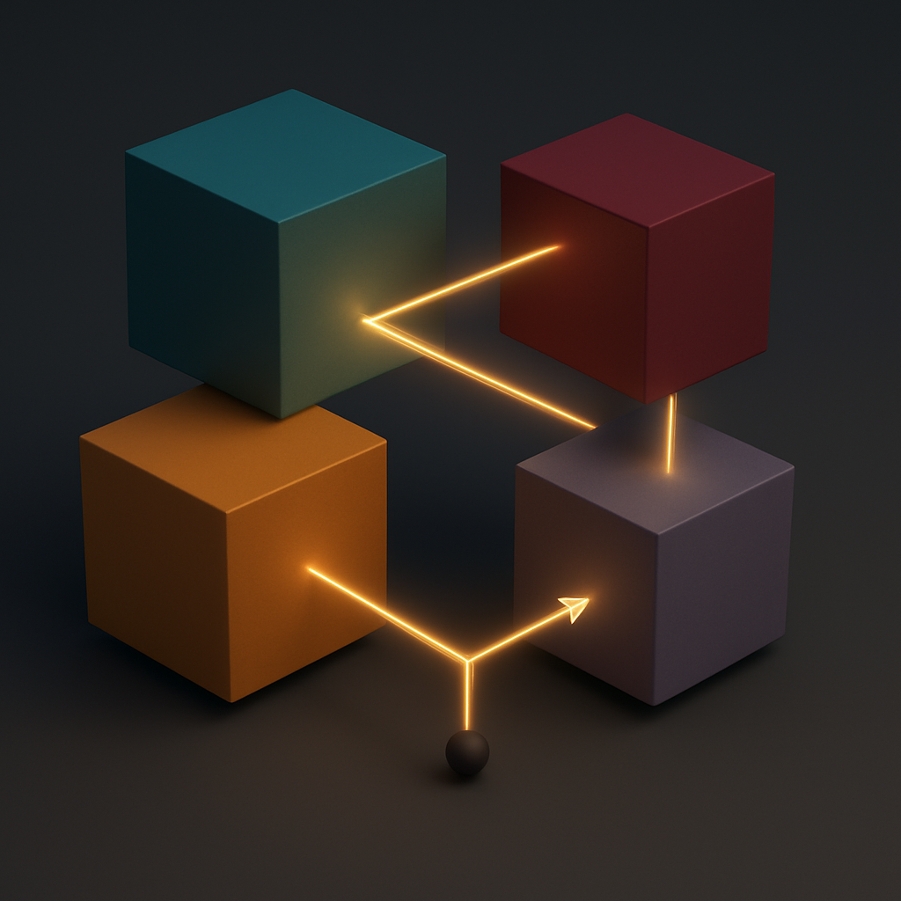

<p align="center">
  
</p>

<h1 align="center">STUR Physics Lab</h1>

<p align="center">
  <strong>STUR-ROLL: cosmic birefringence from integers</strong><br>
  <em>Lambda-CDM plus one derived sector &mdash; |&beta;| = k&alpha;/2, k = 1 &rArr; 0.2091&deg;</em>
</p>

<p align="center">
  <a href="https://creativecommons.org/publicdomain/zero/1.0/"></a>
  
  
  
</p>

---

## The hypothesis

STUR-ROLL adds a single sector to Lambda-CDM, and that sector predicts the
isotropic CMB birefringence angle from integers and symmetry:

> **|&beta;| = k&alpha;/2, with k = 1 &rArr; 0.2091&deg;.** There is no continuous fitted
> parameter and no initial-condition coincidence.

The scope is narrow on purpose. STUR-ROLL is **not** a replacement for
established physics:

- **Gravity is GR** (written as TEGR, embedded in Poincar&eacute; gauge theory), so
  the GR precision tests pass by construction.
- **Dark matter and dark energy are those of Lambda-CDM.** The new sector
  explains neither (see [`docs/HYPOTHESIS.md`](docs/HYPOTHESIS.md)).
- **The new sector carries &lesssim; 2&times;10&#8315;&#8309; of the matter energy.** CMB spectra,
  BAO, supernovae, lensing and BBN are those of Lambda-CDM, so the global model
  comparison reduces to the &beta; likelihood.

> **Relation to prior work.** The observable, &beta; &asymp; 0.21 c_&gamma;&deg; from a hilltop
> axion, was predicted by Lee, Murai, Takahashi & Yin, *Phys. Rev. D* 112,
> 043538 (2025). STUR-ROLL **derives both of their assumptions** from a 5D
> theory: c_&gamma; = 1 from level quantisation, and the hilltop start from a smooth
> birth followed by a brane twist.

## The derived chain

| # | Step | Result |
|---|------|--------|
| A1 | **Axiom: smooth birth.** The universe nucleates with the fifth dimension (S&sup1;/Z&#8322;) closing off smoothly. | the holonomies are trivial at birth: **&theta; = 0 exactly** |
| 1 | Positivity theorem (all orders) | at birth, &theta; = 0 is the minimum of the vacuum energy |
| 2 | 5D Chern&ndash;Simons term, parity anomaly, Z&#8326; | L = (k&alpha;/4&pi;)&theta;FF&#771; with **k &isin; &Zopf;**, k = 1 minimal; a roll by &pi; gives **&beta; = k&alpha;/2 exactly** |
| 3 | **The orbifold twists:** a brane angle &vartheta; rolls 0 &rarr; &pi; | the orbifold parity fixes it at **exactly &pi;**; it acts as a fermion-parity defect, so the bulk fermion becomes periodic |
| 4 | Late-time Wilson-line potential | V = m&sup2;f&sup2;(1 + cos &theta;): the birth value **&theta; = 0 is now the hilltop** |
| 5 | The roll at z &asymp; 4&ndash;300 | &theta;: 0 &rarr; &pi;, **&beta; = &alpha;/2** (computed 0.2081&ndash;0.2094&deg;) |

**Inputs.**
- **Discrete choices:** k = 1; the minimum of the brane potential is at &pi;;
  the brane-angle charges (fermion odd, scalar even).
- **Conditions:** m_&vartheta; &gtrsim; 2H_nuc; H_nuc &lesssim; 0.08 f; 1/L &gtrsim; 0.8&ndash;1.0 TeV; and
  2&times;10&#8315;&sup3;&sup1; &lesssim; m &lesssim; 10&#8315;&sup2;&#8312; eV.
- **Axiom:** A1, the smooth birth.

How the chain was reached: the six refinement rounds in `docs/REFINEMENT_R*.md`.
Full detail: [`docs/HYPOTHESIS.md`](docs/HYPOTHESIS.md).

## Scoreboard

The scoring rule was fixed before the numbers were computed: pass/fail gates
against published measurements at 2&sigma;, then AIC = &chi;&sup2; + 2&times;(fitted
parameters) on &beta;.

| Test | GR+QFT | GR+QFT+axion | **STUR-ROLL** | STUR-2025 (superseded) |
|---|:-:|:-:|:-:|:-:|
| Cassini &gamma;, Mercury perihelion, GW speed, Eot-Wash, MICROSCOPE, electron g&minus;2, BH thermodynamics | 7 PASS | 7 PASS | **7 PASS** | Eot-Wash FAIL |
| CMB birefringence \|&beta;\| (2&sigma;) | FAIL | PASS (fitted) | **PASS (predicted)** | n.d. |
| **passed / failed** | 7 / 1 | 8 / 0 | **8 / 0** | 0 / 2 |

| AIC on &beta; | GR+QFT | axion | **STUR-ROLL** |
|---|--:|--:|--:|
| joint 2026 (ACT DR6 + Planck), 0.277 &plusmn; 0.057&deg; | 23.62 | 2.00 | **1.46** |
| ACT DR6, 0.215 &plusmn; 0.074&deg; | 8.44 | 2.00 | **0.01** |
| WMAP + Planck PR4, 0.342 &plusmn; 0.0925&deg; | 13.67 | 2.00 | 2.10 |

Computed &beta; = 0.2080&deg; (m = 10&#8315;&sup3;&#8304; eV, seed 10&#8315;&#8308;). Pulls:
&minus;1.21, &minus;0.09, &minus;1.45&sigma;.

**Reading this honestly:** against GR+QFT, &Delta;AIC = 8&ndash;22, but that is
the &beta; measurement itself, and it rests on polarization-angle calibration
via Galactic foregrounds. The ACT+Planck authors call the signal a hint. A
systematic would remove the test. Against a generic axion, STUR-ROLL does better
on 2 of 3 datasets, but &Delta;AIC &lt; 2, so the difference is **not yet
significant**. STUR-ROLL's edge is that its &beta; is a prediction while the
axion's is a fit.

## How it can be falsified (LiteBIRD)

STUR-ROLL is ruled out if any of these holds:

0. **&Delta;&beta; = &beta;_reio &minus; &beta;_rec is not in [&minus;0.21&deg;, &minus;0.15&deg;]** (round 2). This
   tomographic test is the sharpest one: about 3&ndash;4&sigma; at LiteBIRD.
1. **|&beta;| moves away from 0.209&deg;.** The amplitude is fixed at &alpha;/2.
2. **|&beta;(low &ell;) &minus; &beta;(high &ell;)| exceeds 0.209&deg;.** This
   test is calibration-free: a miscalibration rotates every &ell; by the same
   angle, so the difference is immune to it. A generic ALP has no such bound.
3. **No single &theta; mass fits the measured &beta;(&ell;).**
4. **Anisotropic birefringence appears at high &ell;.** &theta; = 0 at every
   emission point, so the recombination-era rotation is exactly uniform.

The *shape* of &beta;(&ell;) on its own does **not** discriminate: a generic ALP
with a free mass and a free amplitude reproduces it to an rms of
0.0003&ndash;0.007&deg; ([`src/alp_vs_stur.py`](src/alp_vs_stur.py)). See
[`docs/PREDICTIONS.md`](docs/PREDICTIONS.md).

## Reproduce

```bash
pip install -r requirements.txt
python src/stur_final.py          # ~30 s; output identical to results/stur_final_output.txt
python -m pytest tests/ -q        # regression: output must match EXPECTED_OUTPUT exactly
```

`src/alp_vs_stur.py` additionally needs a CLASS run directory (see
[`docs/STATUS.md`](docs/STATUS.md)).

## Repository layout

```
src/stur_final.py           derived chain, audit (A–E), scoreboard
src/alp_vs_stur.py          can a generic ALP mimic STUR-ROLL's beta(l)?
results/                    captured output of stur_final.py
tests/                      regression + sanity tests (run in CI)
docs/HYPOTHESIS.md          claim, chain, status, consistency checks, new particles
docs/PREDICTIONS.md         beta(l) tables and falsification criteria
docs/STATUS.md              what is derived, assumed, missing, and open
docs/REFINEMENT_R1.md       round 1: literature audit, corrections, open items
docs/REFINEMENT_R2.md       round 2: synthesis of four parallel checks (R2_*.md)
docs/REFINEMENT_R3.md       round 3: Z6 commitment, nucleation phase, Planck tomography
docs/REFINEMENT_R4.md       round 4 (exploratory, superseded): torsion twist
docs/REFINEMENT_R5.md       round 5: the Lagrangian; no 5D torsion twist; positivity theorem; brane-parity twist
docs/REFINEMENT_R6.md       round 6: brane angle fixes the twist at exactly pi; hilltop start derived
docs/REFERENCES.md          bibliography (with verification status)
src/checks/                 independent checks for each refinement round
index.html                  project website (GitHub Pages)
archive/v7-toe/             superseded STUR v7 "Theory of Everything" material
archive/genesis-v10-stur-b/ superseded STUR-B bridge hypothesis (GENESIS v10)
```

## What happened to STUR v7?

The previous framing of this repo (the v7.0 "Theory of Everything" with a
30-observable scorecard, the infinity helix, ERP, and the 2025 tanh(r/1 mm)
gravity law) is superseded. It is preserved unchanged in
[`archive/v7-toe/`](archive/v7-toe/) for the record, together with its website.
The 2025 tanh gravity law fails Eot-Wash and does not flatten rotation curves.
STUR-B (GENESIS v10) needed initial &theta; energy and is excluded by the full
code. See [`archive/README.md`](archive/README.md).

## License

[CC0 1.0](LICENSE) &mdash; Sheldon Lindberg, 2026.
