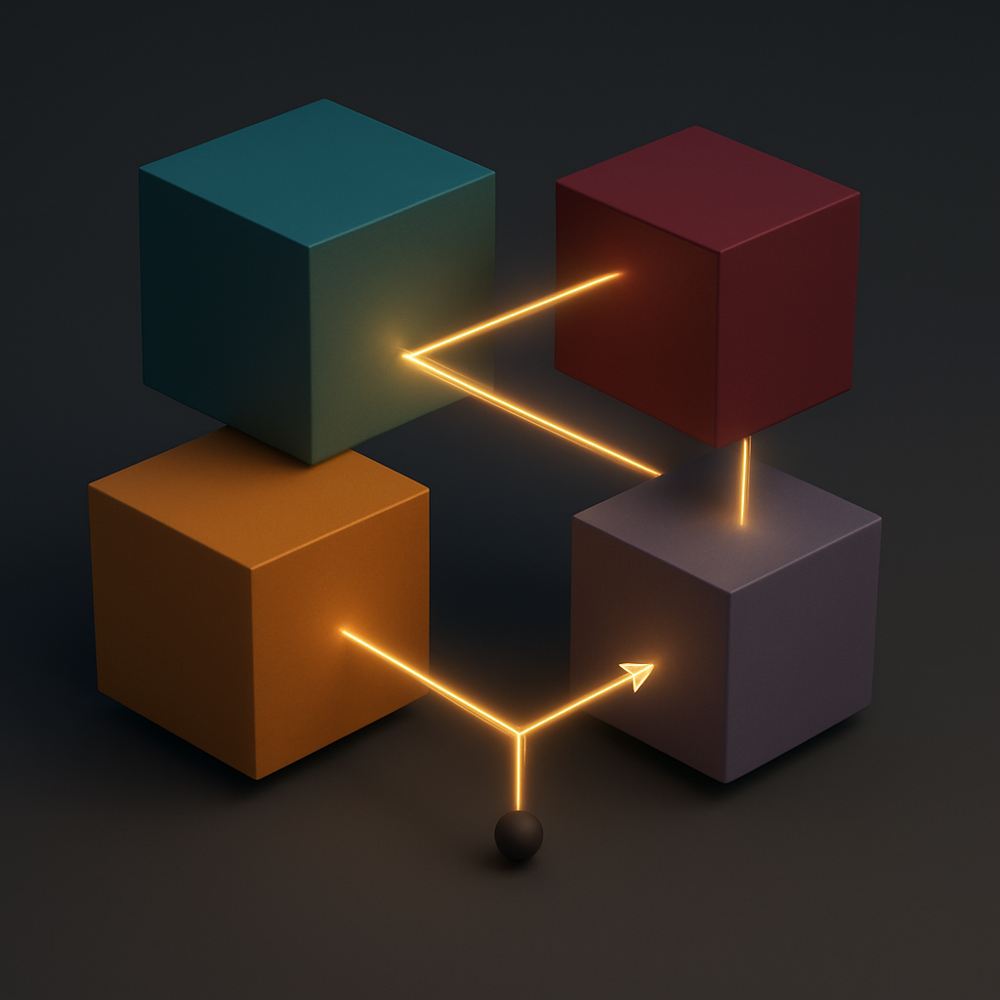

<p align="center">
  
</p>

<h1 align="center">STUR-ROLL</h1>

<p align="center">
  <strong>Cosmic birefringence from integers: |&beta;| = k&alpha;/2 = 0.2091&deg;, with no fitted parameter</strong>
</p>

<p align="center">
  <a href="https://github.com/sheldonlindberg-afk/STUR-Physics-Lab/actions/workflows/tests.yml"></a>
  <a href="https://creativecommons.org/publicdomain/zero/1.0/"></a>
  
  
  
</p>

<p align="center">
  <a href="https://sheldonlindberg-afk.github.io/STUR-Physics-Lab/archive/stur-roll/"><strong>Open the interactive site &rarr;</strong></a>
  &nbsp;&middot;&nbsp; run the roll in your browser, explore the tomography test, read it in plain or technical language
</p>

---

## In plain terms

The oldest light in the universe, the cosmic microwave background (CMB), is
slightly polarized: its electric field prefers one direction. Several recent
measurements suggest that, on its 13.8-billion-year trip to us, that direction
has been turned by about a fifth of a degree.

STUR-ROLL says this turn is not a random number. It proposes a hidden field,
wrapped around a tiny fifth dimension, that started at exactly zero when the
universe was born. Later, a switch at the edge of that dimension flipped,
the field found itself balanced on a hilltop, and it rolled exactly half a
turn. Half a turn of this field rotates light by exactly half of the
fine-structure constant: **&alpha;/2 = 0.2091&deg;**. Nothing is adjusted to
get this number.

The idea is deliberately narrow. It does not replace Einstein's gravity or the
standard model of cosmology, and it does not explain dark matter or dark
energy. It makes one sharp prediction that the LiteBIRD satellite will test.

## For physicists

STUR-ROLL adds one sector to &Lambda;CDM. The field &theta; is the holonomy of a
Z&#8322;-odd U(1)_B on an S&sup1;/Z&#8322; orbifold, coupled to photons by a 5D
Chern&ndash;Simons term at integer level k:

| # | Step | Result | Round |
|---|---|---|---|
| A1 | **Axiom: smooth birth.** The universe nucleates with S&sup1;/Z&#8322; capping off. | holonomies trivial: **&theta; = 0 exactly** | R5, R6 |
| 1 | Positivity theorem, all orders | at birth &theta; = 0 minimises E(&theta;) | R5 |
| 2 | 5D Chern&ndash;Simons term, parity anomaly, Z&#8326; | L = (k&alpha;/4&pi;)&theta;FF&#771;, k &isin; &Zopf;; &Phi;(&pi;) &minus; &Phi;(0) = (&pi;/2) sgn M exactly, so a roll by &pi; gives **&beta; = k&alpha;/2** | R1, R2.2, R3.2 |
| 3 | Orbifold-odd brane angle &vartheta; rolls 0 &rarr; &pi; | parity fixes it at **exactly &pi;**; a fermion-parity defect makes &psi; periodic | R6 |
| 4 | Late-time Wilson-line potential | V = m&sup2;f&sup2;(1 + cos &theta;): the birth value is now the **hilltop** | stur_final |
| 5 | Roll at z &asymp; 4&ndash;300 | &theta;: 0 &rarr; &plusmn;&pi;, **&beta; = &alpha;/2** (computed 0.2081&ndash;0.2094&deg;) | R2.1, R6 |

**Inputs.** Discrete: k = 1; minimum of V(&vartheta;) at &pi;; q_&psi; odd,
q_&phi; even; the Z&#8326; global structure. Conditions: 2&times;10&#8315;&sup3;&sup1;
&lesssim; m &lesssim; 10&#8315;&sup2;&#8312; eV; 0.9 TeV &lesssim; 1/L &lt; f/197;
H_nuc &lesssim; 0.076 f; m_&vartheta; &gtrsim; 2H_nuc. Axiom: A1.

**Prior work.** The observable, &beta; &asymp; 0.21c_&gamma;&deg; from a hilltop
axion, is due to Lee, Murai, Takahashi & Yin, *Phys. Rev. D* **112**, 043538
(2025). STUR-ROLL derives both of their assumptions, c_&gamma; = 1 and the
hilltop start, from a 5D theory.

Full statement: [`docs/HYPOTHESIS.md`](docs/HYPOTHESIS.md).

## Evidence so far

Scoring rule, fixed before computing: pass/fail gates at 2&sigma;, then
AIC = &chi;&sup2; + 2&times;(fitted parameters) on &beta;.

| Measurement of &beta; | Value | Pull | AIC: no new physics | fitted axion | **STUR-ROLL** |
|---|---|---|--:|--:|--:|
| ACT DR6 + Planck (2026) | 0.277 &plusmn; 0.057&deg; | &minus;1.21&sigma; | 23.62 | 2.00 | **1.46** |
| ACT DR6 | 0.215 &plusmn; 0.074&deg; | &minus;0.09&sigma; | 8.44 | 2.00 | **0.01** |
| WMAP + Planck PR4 | 0.342 &plusmn; 0.0925&deg; | &minus;1.45&sigma; | 13.67 | 2.00 | 2.10 |

All seven gravity and particle-physics precision gates (Cassini, Mercury,
GW170817, E&ouml;t-Wash, MICROSCOPE, electron g&minus;2, black-hole
thermodynamics) pass by construction, because the gravity sector is GR.

**Reading this honestly.** Against "no new physics", &Delta;AIC = 8&ndash;22, but
that is the &beta; measurement itself, which depends on calibrating the
polarization angle against Galactic foregrounds; the teams call it a hint.
Against a generic fitted axion, STUR-ROLL does better on two of three datasets,
but &Delta;AIC &lt; 2 is not yet significant. STUR-ROLL's edge is that its &beta;
is predicted, not fitted.

## How it can be falsified (LiteBIRD)

STUR-ROLL is ruled out if any of these holds:

1. **Tomography.** |&beta;| &asymp; 0.2&deg; is confirmed but the
   reionization-minus-recombination difference &Delta;&beta; &asymp; 0, with no
   large-scale anisotropic reionization rotation. STUR-ROLL predicts
   &Delta;&beta; &isin; [&minus;0.209&deg;, &minus;0.122&deg;], 2.4&ndash;4.2&sigma; from
   zero at LiteBIRD (R2.1, corrected in R7).
2. **Amplitude.** |&beta;| moves away from 0.209&deg;.
3. **Calibration-free gap.** |&beta;(low &ell;) &minus; &beta;(high &ell;)| exceeds
   0.209&deg;.
4. **Shape.** No single &theta; mass fits the measured &beta;(&ell;).
5. **Isotropy.** Anisotropic birefringence appears at high &ell;.

The shape of &beta;(&ell;) alone does not discriminate: a generic ALP with free
mass and amplitude reproduces it to 0.0003&ndash;0.007&deg;
([`src/alp_vs_stur.py`](src/alp_vs_stur.py)). Details:
[`docs/PREDICTIONS.md`](docs/PREDICTIONS.md).

## What it would mean if it is right

In short: a new, extraordinarily light field (2&times;10&#8315;&sup3;&sup1;&ndash;10&#8315;&sup2;&#8312; eV)
fills the universe; the universe distinguishes left from right in how it treats
light; the rotation is set by a whole number, as electric charge is; and, if
STUR-ROLL is the reason, space has a compact fifth dimension whose shape was fixed
at the birth of the universe. General relativity and &Lambda;CDM would stand
unchanged, and dark matter and dark energy would still need their own
explanations: round 8 tested the sector's two natural candidates against
preregistered criteria and ruled both out
([`docs/REFINEMENT_R8.md`](docs/REFINEMENT_R8.md)). See [`docs/IMPLICATIONS.md`](docs/IMPLICATIONS.md), which separates
what the data alone would establish from what is specific to STUR-ROLL.

## Verification

The math has been through nine refinement rounds. Round 7
([`docs/REFINEMENT_R7.md`](docs/REFINEMENT_R7.md)) recomputed every number,
including an independent re-integration of the roll, and corrected seven
statements; the headline &beta; = &alpha;/2 was unaffected. Every round has a
script in [`src/checks/`](src/checks/), and CI runs:

- `pytest`: the full output of `stur_final.py` must match line for line, plus
  physics checks (closed forms, exact integrals, positivity, the brane twist,
  the round-7 corrections);
- `node --test`: the website's simulator must reproduce the Python roll to four
  decimals.

## Reproduce

```bash
pip install -r requirements.txt
python src/stur_final.py          # ~30 s; identical to results/stur_final_output.txt
python src/checks/r7_audit.py     # ~1.5 min; the round-7 math audit
python -m pytest tests/ -q        # 12 tests, ~1 min
node --test tests/web_sim.test.mjs
```

`src/alp_vs_stur.py` additionally needs a CLASS run directory (see
[`docs/STATUS.md`](docs/STATUS.md)).

## Repository layout

```
index.html, assets/          the interactive site (GitHub Pages)
  assets/js/stur-roll-sim.js   browser port of the roll, tested against Python
  assets/js/stur-roll-app.js   page logic: reading mode, charts, tomography
src/stur_final.py            derived chain, audit A-E, scoreboard (kept as uploaded)
src/alp_vs_stur.py           can a generic ALP mimic STUR-ROLL's beta(l)?
src/checks/                  one script per refinement round (r7_audit.py: the full audit)
results/                     captured output of stur_final.py
tests/                       Python regression + physics tests; web simulator test
docs/HYPOTHESIS.md           the claim, chain, constraints, predictions
docs/PREDICTIONS.md          beta(l), tomography, falsification criteria
docs/IMPLICATIONS.md         what it would mean for physics if confirmed
docs/GLOSSARY.md             every term, in plain and precise language
docs/STATUS.md               what is derived, corrected, assumed, and open
docs/REFINEMENT_R1-R9.md     the nine refinement rounds (R2_*.md: round-2 detail)
docs/R8_PREREGISTRATION.md   round-8 criteria, committed before the calculation
docs/R9_PREREGISTRATION.md   round-9 criteria (Cabibbo angle), committed before the calculation
docs/ARCHIVE_TRIAGE.md       every archive claim screened against preregistered gates
docs/REFERENCES.md           bibliography, with verification status
archive/                     superseded material (STUR v7, GENESIS v10), kept for the record
```

## Citing

See [`CITATION.cff`](CITATION.cff). The repository is released under
[CC0 1.0](LICENSE): no rights reserved.

## What happened to STUR v7?

The earlier "Theory of Everything" framing (the infinity helix, ERP, the
30-observable scorecard, and the 2025 tanh(r/1 mm) gravity law) is superseded
and preserved unchanged in [`archive/v7-toe/`](../v7-toe/). The tanh
gravity law fails E&ouml;t-Wash and does not flatten rotation curves. STUR-B
(GENESIS v10) needed initial &theta; energy and is excluded. See
[`archive/README.md`](../README.md).
